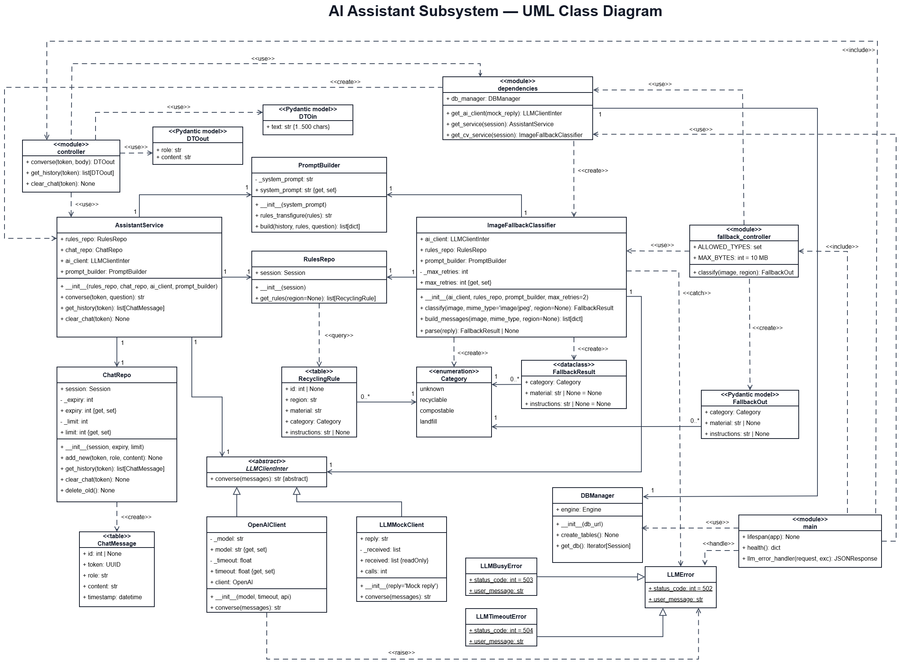
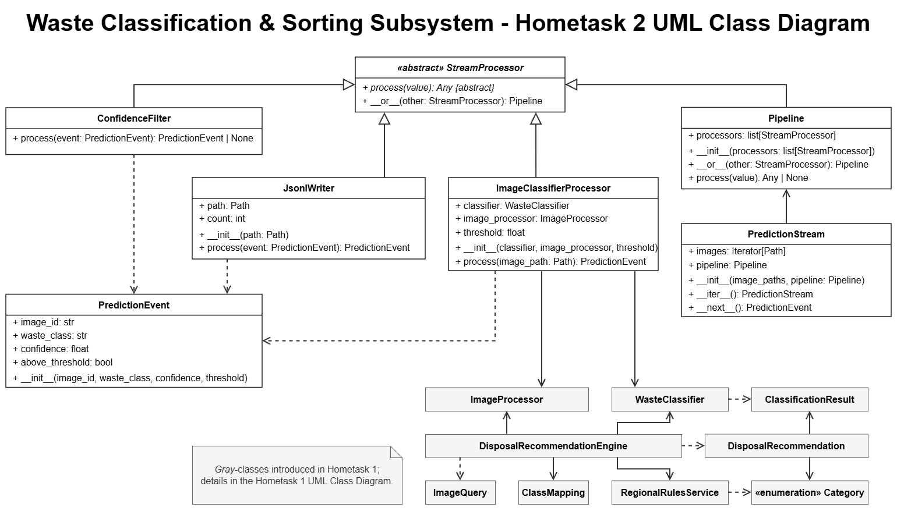
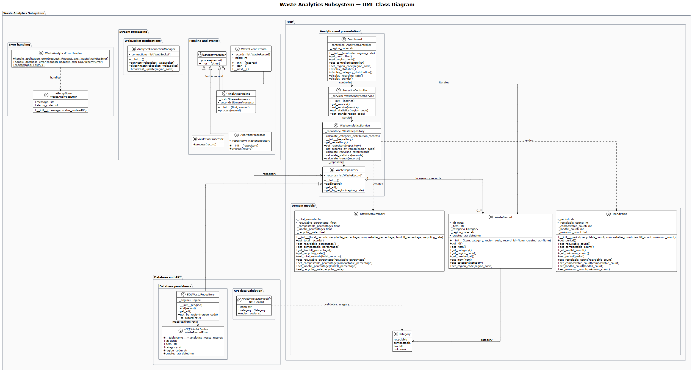

# AI-Powered Waste Sorting & Recycling Assistant

**Platform name:** DiliGen

**Subtopic:** CV- and LLM-Based Waste Awareness Assistant for German Citizens

**Requirements:** see [REQUIREMENTS.md](REQUIREMENTS.md) for the functional and non-functional requirements of the system.

### Team Overview

|       Member        | Matr. No. |          Subsystem         |
| ------------------- | --------- | -------------------------- |
| Anastasiia Shovkova | 7219229   | `dashboard_subsystem`      |
| Evgenii Kuryshev    | 7227176   | `classification_subsystem` |
| Illia Parkhomenko   | 7219649   | `assistant_subsystem`      |

---

### Presentation

[Watch the team video review](https://drive.google.com/file/d/1YO0KFPLoPeMhx9o4M55ELHq1SLZFGHit/view)

[Watch the team presentation slides](https://www.youtube.com/)

---

### How to Run the System

There are three ways to use the system.

#### 1. Hosted website

**https://diligen.netlify.app/**

The services run on free hosting and sleep when idle, so the first visit can take about a minute while each page shows that its service is starting.

The frontend is hosted on Netlify and each backend service on Render.

#### 2. Run locally

Requires Python 3.12 and Node 22.12 or newer. Run all commands from the repository root.

Running locally needs our `.env` file, which we can provide on request. The hosted website needs no setup.

1. Create and activate one virtual environment for the whole project:
   ```
   py -3.12 -m venv .venv
   .venv\Scripts\Activate.ps1
   ```
   On macOS/Linux: `python3.12 -m venv .venv` and `source .venv/bin/activate`. In VS Code or PyCharm, select `.venv` as the project interpreter.
2. Install the requirements of all three services (torch is the CPU-only build):
   ```
   pip install -r requirements.txt
   ```
   This takes several minutes. pip shows no progress while it unpacks torch, so wait for "Successfully installed".
3. Install the frontend packages once, then go back to the root:
   ```
   cd frontend
   npm install
   cd ..
   ```
4. Copy `.env.example` to `.env` and fill in the values. The file must be in the repository root, next to `main.py`. A `.env` inside a subsystem folder is not read by the other services.
5. Start everything from the root:
   ```
   python main.py
   ```

This starts the assistant on port 8000, classification on 8001, the dashboard on 8002 and the frontend on http://localhost:5173. Press Ctrl+C to stop all of them. Do not run it at the same time as Docker, since both use the same ports.

#### 3. Run with Docker

Only Docker Desktop is needed. Run the commands from the repository root.

1. Copy `.env.example` to `.env` and fill in the values.
2. Build and start all four containers:
   ```
   docker compose up --build
   ```
3. Open http://localhost:5173. Press Ctrl+C to stop, then `docker compose down` to remove the containers.

The first build takes several minutes because of torch. Inside Docker the services reach each other by name (for example `http://assistant:8000`), which `docker-compose.yml` sets, so the URLs in `.env` are only used by `python main.py`.

#### Run the tests

Each subsystem has its own tests. With the virtual environment active, from the repository root (use `python -m pytest`, not plain `pytest`, so the subsystem packages can be imported):
```
cd assistant_subsystem/backend
python -m pytest
cd ../..
python -m pytest classification_subsystem/backend/tests
cd dashboard_subsystem
python -m pytest
cd ..
```
Set `USE_SQLITE=1` before the dashboard tests so they use a local SQLite database instead of Neon (PowerShell: `$env:USE_SQLITE="1"`, macOS/Linux: `export USE_SQLITE=1`). The assistant tests use a mock AI client and an in-memory database, so they need no API key.

---

### Assistant Subsystem

An educational chat about waste sorting, recycling, composting and the circular economy for people in Germany, plus an image fallback for the classification subsystem.

* **Chat.** The assistant answers only questions about waste and sustainability and politely declines other topics. For local questions it uses the regional recycling rules stored in the database and names the region a rule comes from. When the stored rules do not cover an item or region, it says so and refers the user to the local municipality. It asks one clarifying question when a question is too broad or the region is missing, and it answers in the language of the user's message. An empty chat offers starter questions.
* **History.** Each browser session gets its own chat ID, with no accounts. The conversation is stored for one day, the last 20 messages are sent to the model as context, and the user can clear the chat at any time.
* **Image fallback.** When the CV model is not confident enough, the classification subsystem sends the photo to `POST /fallback/classify`. The model receives the regional rules of the selected city and returns a material, category and disposal instructions, or "unknown" instead of guessing.
* **Errors and cost.** If the model call fails or times out, the API returns a clear message (status 502, 503 or 504) that the page shows to the user. Without an API key a mock AI client is used, so the subsystem can run and be tested at no cost.

**Class diagram:**


### Classification Subsystem

The user uploads a photo of a waste item (JPEG, PNG or WebP, up to 10 MB), or takes one with the phone camera, and selects a city from the list of regions stored in the database.

* **Classification.** The image is checked, converted to RGB and padded to 224 × 224 without distorting its proportions. A pre-trained ResNet50 then predicts one of 12 labels (battery, biological, brown glass, cardboard, clothes, green glass, metal, paper, plastic, shoes, trash and white glass) with a confidence score. `class_mapping.json` maps each label to a material used in the regional rules, so the model can be replaced by updating only this file.
* **Recommendation.** If the confidence is at least 70% and the label has a material, `DisposalRecommendationEngine` reads the category (recyclable, compostable or landfill) and the disposal instructions for that material and city from the shared regional rules table in Neon. The page shows the item, its category, what to do with it and the city the rule applies to.
* **Fallback.** Otherwise the photo is sent to the assistant's image fallback. If no material can be identified there either, the user is asked for another photo instead of receiving a guessed recommendation. Unsupported regions and files that are not valid images are rejected with a clear message.
* **Statistics.** Each confident CV result is sent to the dashboard as material, category and region, protected by a shared secret key. The photo and the recommendation text are not sent, and uploaded photos are not stored. If the dashboard is unavailable, the user still receives the recommendation.

**Class diagram:**


### Dashboard Subsystem

The dashboard collects, processes and presents statistics about classified waste for municipalities and other interested parties.

* **Collecting.** The classification subsystem sends each record to `POST /analytics/records`, which requires a shared secret key. Each record passes through a processing pipeline: `ValidationProcessor` checks that the material and region are not empty and that the category is valid, and `AnalyticsProcessor` stores the record with its date and time in Neon, or in a local SQLite database for development. Invalid records are rejected with a clear error message, and database errors return a short message without crashing the service.
* **Statistics.** For one region or all regions, the dashboard shows the total number of classified items and their distribution across recyclable, compostable, landfill and unknown waste as a donut chart with percentages.
* **Trends.** A daily trend chart shows one line per category, and each point shows its date, category and number of items. A separate card shows the day with the highest activity and how many items were classified on it.
* **Filters.** The statistics can be filtered by region and by period (last 7 days, last 30 days, all time). The region list is built from the regions that have records, and regions or periods without records show an empty state.
* **Live updates.** The page keeps a WebSocket connection (`/analytics/ws`) and reloads the statistics as soon as a new record arrives for the selected region. A status indicator shows whether the connection is active. If the connection drops, it reconnects automatically, and the data is refreshed when the user returns to the tab or the device goes back online.

**Class diagram:**


---

### Tech Stack and Rationale

* **Backend: Python and FastAPI.** Asynchronous by design, with built-in support for WebSockets and streaming responses, which leaves room to stream AI answers later. We chose it over Django, which bundles user accounts, an admin panel and templates that we don't need, since the project has no logins. Flask is just as light, but it needs extra libraries for input validation and API documentation. FastAPI provides both out of the box: Pydantic checks every request (for example the 500-character limit on chat messages), and it generates an interactive API page (/docs) automatically.
* **Database: Neon.tech (serverless PostgreSQL).** Neon offers PostgreSQL with a free tier, so the team gets a hosted database with no server to maintain. We chose PostgreSQL over MySQL because it gives reliable transactions and is strong at the analytical queries the dashboard needs (grouping and aggregating waste records by region and time).
* **ORM: SQLModel.** SQLModel maps Python table models to the database, and the same classes serve as API schemas. The code works with both PostgreSQL and a local SQLite database, which the dashboard supports for local runs. Protects the platform from SQL injection attacks.
* **Data processing: Pandas.** Pandas counts classifications by category. The analytics API returns summary statistics and daily trends as compact JSON, so plotting libraries stay out of the backend to save server resources.
* **Frontend and charts: React (Vite).** React handles the page state, such as the chat and the service status. The charts need no chart library: the daily trend chart is drawn with SVG and the category distribution chart with CSS, both in the browser from the backend's JSON, so no images are sent over the network. The dashboard updates live over a WebSocket when new records arrive.
* **AI model: OpenAI gpt-6-luna.** Our chat answers are short and our fallback only needs 1-3 values as a response, so this new lightweight model is enough, and it also keeps the API cost small for a student project. The model name is set in one place, so we can switch to a stronger model without changing much code.
* **Architecture and deployment: microservices on Render, frontend on Netlify.** Each subsystem runs as its own FastAPI service on Render, and the services talk to each other over HTTP. Only classification loads torch and the CV model, so the chat and the dashboard stay light within Render's 512 MB free instances, and if one service fails the other pages keep working. Each of us could also develop and deploy our subsystem independently. Netlify hosts the React build and forwards API requests to the matching Render service, so no CORS setup is needed. The trade-off is that free services sleep when idle, so each page shows a loading screen while its service wakes up. Both platforms deploy from the `main` branch.
* **Version control: GitHub.** One repository holds all three subsystems and the frontend. Each homework task has its own branch.
* **Testing: Pytest and HTTPX.** Pytest fixtures set up test data and dependencies, for example a clean in-memory database for the assistant. FastAPI's TestClient, which is built on HTTPX, exercises the API endpoints in-process without running a server. The assistant tests use a mock LLM client, so they need no API key and cost nothing.
* **CV Model: ResNet50 Garbage Classification v1.2.** This pre-trained model is used to predict one of 12 waste labels for an image. The system prepares a 224 × 224 RGB image and applies the normalization used by the included weights. The model README in classification_subsystem lists the labels, training-data source and limitations.

---

### Repository Organization

Branch **main** holds the final version of the platform, which is deployed to Render and Netlify.

Files and descriptions for each separate homework task can be found across the 4 branches:
* **Homeworkassignment001**
* **Homeworkassignment002**
* **Homeworkassignment003**
* **Homeworkassignment004**
  
Branch **capstone-integration** was used for subsystem merging during the final stage of the project.

Branch **dev** was used during the development process and does not hold the final version of the platform.

Branch **main-old** is the initial branch that holds the first few commits.

---
