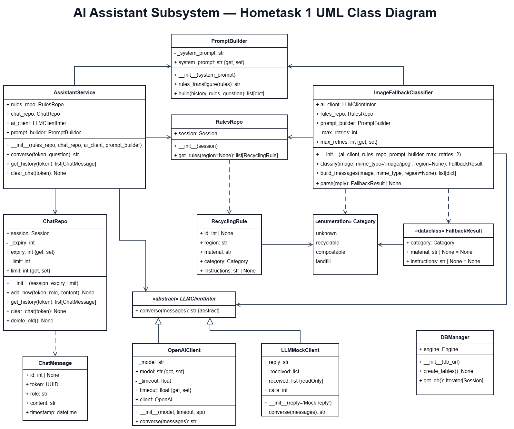

# Waste Sorting and Recycling Assistant

## Hometask3. Web APIs & Database Access Layers

> The aim of this work is to learn how to create a simple Django or Flask project and use it with MySql for data output.
> 
> To create your first application please follow Django documentation or Flask documentation https://flask.palletsprojects.com/en/stable/quickstart/
> 
> Create your project at the github and apply the link your project. Add your indentification and update the readme file with the project information.
---
### Waste Classification & Sorting Subsystem

**Responsible:** Evgenii Kuryshev

In Hometask 3, the subsystem replaces its JSON file of regional disposal rules with a `classification_recycling_rules` table in Neon/PostgreSQL. `RegionalRulesService` now reads the table to provide the available regions, check the region selected for a request, and find the category and disposal instructions after the CV model identifies a mapped material with at least 70% confidence. The confident CV result can then be sent to the analytics API.

The new FastAPI endpoint accepts an image and region and returns the recommendation as JSON. If the CV result is uncertain, the subsystem sends the original image and region to the AI Assistant API and returns its instructions directly. This path does not read a disposal rule for the predicted material.

#### Classes

**Retained from Hometasks 1 and 2**

- `ImageQuery` holds the image, selected region and image MIME type.
- `ImageProcessor` opens an image and prepares a 224 × 224 RGB image for the CV model.
- `WasteClassifier` loads the pretrained model and predicts a label and confidence.
- `ClassificationResult` holds the identified material, confidence and result source (`cv` or `ai`).
- `ClassMapping` maps a model label to the material name used by the rules.
- `RegionalRulesService` reads available regions and disposal rules from Neon/PostgreSQL.
- `Category` defines `unknown`, `recyclable`, `compostable` and `landfill`.
- `DisposalRecommendation` holds the response status, message, region, category and optional classification.
- `DisposalRecommendationEngine` chooses the CV or AI path and coordinates the recommendation and analytics record.
- `PredictionEvent` holds one image prediction and whether it passes the confidence threshold.
- `StreamProcessor` defines the common abstract `process()` method for stream stages.
- `ImageClassifierProcessor` turns an image path into a prediction event.
- `JsonlWriter` writes prediction events to a JSONL file.
- `ConfidenceFilter` stops low-confidence events from reaching later stages.
- `Pipeline` runs stream processors in sequence.
- `PredictionStream` iterates over images and yields events that pass through the pipeline.

**Added in Hometask 3**

- `RecyclingRule` represents a regional rule in the `classification_recycling_rules` SQLModel table.
- `FallbackResult` holds the category, material and instructions returned by the AI Assistant.
- `AssistantFallbackClient` sends uncertain images and regions to the AI Assistant API.
- `AnalyticsClient` sends confident CV results to the analytics API.

#### Class Diagram

To be added.

#### Model

The subsystem uses [ResNet50 Garbage Classification v1.2](https://huggingface.co/kendrickfff/my_resnet50_garbage_classificationv1.2), which predicts one of 12 waste labels for an image. `ImageProcessor` prepares a 224 × 224 RGB image; `WasteClassifier` applies the normalization used by the included weights. The [model README](classification_subsystem/backend/model/README.md) lists the labels, training-data source and limitations.

#### Run

From the repository root, install the dependencies and start the API:

```powershell
python -m pip install -r classification_subsystem/backend/requirements.txt
python -m uvicorn classification_subsystem.backend.src.main:app --port 8001
```

Open `http://127.0.0.1:8001/docs`. `GET /classification/regions` returns the regions stored in the rules table. `POST /classification/recommend` accepts an image and one of those regions and returns a classification and disposal recommendation.

---

### Waste Analytics & Dashboard Subsystem

**Responsible:** Anastasiia Shovkova

In Hometask 3, the Waste Analytics Subsystem adds database persistence using SQLModel and PostgreSQL (Neon). Previously, waste records were stored in an in-memory repository. Now, the subsystem can store and retrieve records from a database.

The subsystem also provides FastAPI endpoints for adding waste records, retrieving available regions, calculating category distributions, recyclable share, and daily trends.

Incoming records pass through the validation and analytics pipeline implemented in Hometask 2 before being saved. The analytics functionality from Hometask 1 is reused to calculate statistics from stored records.

#### Classes

**Retained from Hometasks 1 and 2**

- `Category` defines four waste categories: `recyclable`, `compostable`, `landfill`, and `unknown`.
- `WasteRecord` represents a classified waste item with its category, region, ID, and creation timestamp.
- `WasteRepository` provides in-memory record storage and retrieval.
- `WasteAnalyticsService` calculates category distribution, recyclable share, statistics, and daily trends.
- `StatisticsSummary` stores calculated statistics for a region.
- `TrendPoint` represents daily category counts.
- `AnalyticsController` connects the analytics service to the Dashboard.
- `Dashboard` displays analytics results.
- `StreamProcessor` defines the abstract `process()` method and supports operator overloading.
- `AnalyticsPipeline` combines stream processors and executes them sequentially.
- `ValidationProcessor` validates incoming waste records.
- `AnalyticsProcessor` saves validated records through a repository.
- `WasteEventStream` implements an iterator for processing records one at a time.
- `AnalyticsConnectionManager` manages WebSocket connections and sends analytics update notifications.

**Added in Hometask 3**

- `WasteRecordRow` represents a database record using SQLModel and maps to the `analytics_waste_records` table.
- `SQLWasteRepository` implements database operations for adding, retrieving, and filtering waste records.
- `NewRecord` defines and validates the input data received by the FastAPI endpoint.

The `database.py` module configures the database engine and sessions. It supports PostgreSQL through Neon and local SQLite for testing.

The `api.py` module exposes FastAPI endpoints and connects the API, processing pipeline, SQL repository, and analytics service.

#### Class Diagram

To be added.

#### Model

The Waste Analytics Subsystem does not use a separate machine learning model. It receives waste classification results and processes them for statistical analysis.

Records are stored using SQLModel. PostgreSQL (Neon) is used for persistent storage, while SQLite provides a local alternative for testing without external database credentials.

The stored data includes the classified item, waste category, region code, record ID, and timestamp.

#### Run

From the repository root, install the dependencies:

```powershell
cd dashboard_subsystem
python -m pip install -r requirements.txt
```

For local testing with SQLite (Windows PowerShell):

```powershell
$env:USE_SQLITE="1"
python -m uvicorn waste_analytics.api:app --reload
```

Open the interactive API documentation:

`http://127.0.0.1:8000/docs`

Available endpoints:

- `GET /health` — checks API health.
- `POST /analytics/records` — validates and saves a waste record.
- `GET /analytics/regions` — returns available regions.
- `GET /analytics/{region_code}/statistics` — returns analytics statistics for a region.
- `GET /analytics/{region_code}/trends` — returns daily waste classification trends.

If API-key protection is enabled, POST requests require the configured `x-analytics-key` header. Database credentials and secrets must not be committed to GitHub.

To run the tests:

```powershell
python -m pytest tests -v
```

**Test result:** 15 passed, 1 warning.

The API was also tested locally with SQLite. Records can be created through FastAPI and retrieved through the statistics endpoints.

---

### AI Assistant Subsystem

**Responsible:** Illia Parkhomenko

In Hometask 3, the subsystem becomes a FastAPI application. It exposes the chat (`POST`, `GET` and `DELETE /chat/{token}`) and the photo fallback (`POST /fallback/classify`), which the Classification subsystem calls when the CV model is uncertain. Chat history and rules are stored through SQLModel in Neon/PostgreSQL, and the rules come from the `classification_recycling_rules` table shared with the Classification subsystem. Without `DATABASE_URL` the application uses an in-memory SQLite database, and without `OPENAI_API` it uses the mock client, so it starts without any credentials.

#### Classes

**Retained from Hometask 1**

`LLMClientInter`, `OpenAIClient`, `LLMMockClient`, `PromptBuilder`, `AssistantService`, `ChatRepo`, `ChatMessage`, `RulesRepo`, `RecyclingRule`, `Category`, `ImageFallbackClassifier`, `FallbackResult` and `DBManager`. `RecyclingRule` now maps to the shared rules table, and `DBManager` keeps one shared connection for SQLite so the in-memory database works across request threads.

**Added in Hometask 3**

- `DTOin` validates the chat request body (1 to 500 characters).
- `DTOout` is a chat message returned by the API (`role`, `content`).
- `FallbackOut` is the response of `/fallback/classify`.

#### Class Diagram



The diagram is unchanged from Hometask 1. The three classes above are Pydantic schemas for the API and are not shown.

#### Run

From the repository root:

```powershell
cd assistant_subsystem/backend
docker build -t assistant-subsystem .
docker run -p 8000:8000 assistant-subsystem
```

Open `http://127.0.0.1:8000/docs`. This starts with the mock AI and an in-memory database. To use the real services, add `-e DATABASE_URL="<Neon connection string>" -e OPENAI_API="<OpenAI key>"` to the `docker run` command, and never commit these values.
