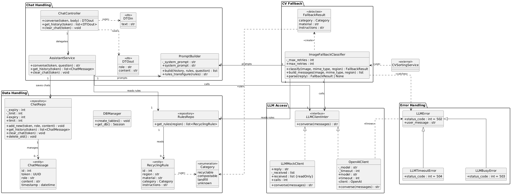

# AI-Powered Waste Sorting & Recycling Assistant

**Platform name:** DiliGen
**Subtopic:** CV- and LLM-Based Waste Awareness Assistant for German Citizens

## Team Overview

|       Member        | Matr. No. |          Subsystem         |
| ------------------- | --------- | -------------------------- |
| Anastasiia Shovkova | 7219229   | `dashboard_subsystem`      |
| Evgenii Kuryshev    | 7227176   | `classification_subsystem` |
| Illia Parkhomenko   | 7219649   | `assistant_subsystem`      |


## Presentation

[Watch the team presentation](https://www.youtube.com/)
Video: https://www.youtube.com/


## System Design

### Assistant subsystem

**Description:**
An educational chat about waste, recycling and the circular economy for German citizens, plus a one-shot image fallback. When the CV model cannot classify an image, the fallback asks an LLM and returns a category with disposal instructions. The chat uses the regional recycling rules stored in the database and keeps its history for a limited time, per browser session, with no accounts.

**Class diagram:**


Each box is a package that matches a file in `assistant_subsystem/backend/src`: `chat_handler_classes.py`, `data_handler_classes.py`, `llm_access_classes.py`, `cv_fallback_classes.py` and `errors.py`.


### Classification subsystem

**Description:**
**Class diagram:**

### Dashboard subsystem

**Description:**
The dashboard block provides statistics for municipalities and responsible for collecting, processing, and presenting waste classification statistics for different regions. It reads the stored waste data and shows clear metrics and visualisations about waste composition as well as recycling-related rates.

**Class diagram:**


## Tech Stack and Rationale

* **Backend: Python and FastAPI.** Asynchronous by design, with built-in support for WebSockets and streaming responses, which leaves room to stream AI answers later. We chose it over Django, which bundles user accounts, an admin panel and templates that we don't need, since the project has no logins. Flask is just as light, but it needs extra libraries for input validation and API documentation. FastAPI provides both out of the box: Pydantic checks every request (for example the 500-character limit on chat messages), and it generates an interactive API page (`/docs`) automatically.
* **Database and media storage: Neon.tech (serverless PostgreSQL) and Cloudinary.** Neon offers PostgreSQL with a free tier, so the team gets a hosted database with no server to maintain. We chose PostgreSQL over MySQL because it gives reliable transactions and is strong at the analytical queries the dashboard needs (grouping and aggregating waste records by region and time). Only image URLs go into the database, never raw image data. Cloudinary stores the images and serves them through a CDN.
* **ORM: SQLModel / SQLAlchemy.** Table models and API schemas use the same Python classes. It works the same with either database, so the application code does not depend on the PostgreSQL choice.
* **Data processing: Pandas.** It aggregates the raw logs on the backend into compact JSON for the dashboard. Plotting libraries stay out of the backend to save server resources.
* **Frontend and charts: React (Vite) with Recharts or Chart.js.** React handles the live chat state. Charts are drawn in the browser from the backend's JSON, so no static images are sent over the network.
* **AI model: OpenAI `gpt-6-luna`.** Our chat answers are short and our fallback only needs 1-3 values as a response, so a low-cost model is enough, and it keeps the API cost small for a student project. The model name is set in one place, so we can switch to a stronger model without changing the code.
* **Deployment: Netlify and Render.** The frontend and backend are deployed separately. Netlify hosts the React build, and Render runs the FastAPI service. Both deploy automatically when we push to GitHub.
* **Version control and CI/CD: GitHub.** One repository holds all three subsystems. Each task has its own branch, and pushes trigger the deployments.
* **Testing: Pytest and HTTPX.** Pytest fixtures give each test a clean in-memory database. HTTPX and FastAPI's built-in test client exercise the endpoints without running a server, and the OpenAI client is replaced by a mock, so tests need no API key and cost nothing.


## How to Run the System

### Assistant Subsystem

1. Go to the backend folder and build the image:
   ```bash
   cd assistant_subsystem/backend
   docker build -t assistant-subsystem .
   ```
2. Start the service with your own Neon connection string and OpenAI key:
   ```bash
   docker run -e DATABASE_URL="<your Neon connection string>" -e OPENAI_API="<your OpenAI key>" -p 8000:8000 assistant-subsystem
   ```
3. Open http://127.0.0.1:8000/docs for the API and http://127.0.0.1:8000/health for the health check.

Tests (no keys needed):
```bash
docker run --rm assistant-subsystem pytest /app/tests
```

### Classification Subsystem

### Dashboard Subsystem


## Homework Mapping

### Assistant Subsystem

**Hometask 1 (OOP)**
- Constructors: every class sets up its own state in `__init__`, for example `OpenAIClient(model, timeout, api)` and `ChatRepo(session, expiry, limit)`.
- Initialization methods: `DBManager.create_tables()` and `DBManager.get_db()`.
- Encapsulation (`@property` getters and setters): `PromptBuilder.system_prompt`, `ChatRepo.expiry` and `limit`, `ImageFallbackClassifier.max_retries`, `OpenAIClient.model` and `timeout`, and the read-only `LLMMockClient.received`.

**Hometask 2 (Real-time data processing)**
[TO ADD]

**Hometask 3 (Web API and database)**
FastAPI with PostgreSQL (Neon) and SQLModel, approved by the teacher instead of Flask/Django and MySQL. API docs are at `/docs`.

**Hometask 4 (Exceptions and tests)**
Error classes in `errors.py` (`LLMError`, `LLMBusyError`, `LLMTimeoutError`), and 18 Pytest tests in `assistant_subsystem/backend/tests`. Run them with `pytest` from `assistant_subsystem/backend`.


### Classification Subsystem

### Dashboard Subsystem

**Hometask 1 (OOP) — Waste Analytics Subsystem**

- **Constructors:** All seven main classes initialize their own state in `__init__`, for example `WasteRecord(item, category, region_code, record_id=None, created_at=None)`, `WasteRepository()`, `WasteAnalyticsService(repository)`, `AnalyticsController(service)`, and `Dashboard(controller, region_code)`. The `StatisticsSummary` and `TrendPoint` constructors initialize the calculated analytics data.
- **Initialization methods:** `WasteRepository.__init__()` initializes an empty list of records. `WasteRecord.__init__()` automatically generates a unique UUID and a creation timestamp when these are not provided. `main()` creates and connects the Repository, Service, Controller, and Dashboard objects using dependency injection.
- **Encapsulation (getters and setters):** `WasteRecord` provides getters for its five attributes and setters for `item`, `category`, and `region_code`, while keeping the ID and creation timestamp read-only through its public methods. `StatisticsSummary` and `TrendPoint` provide getters and setters for their analytics values. `AnalyticsController` encapsulates `service`, and `Dashboard` encapsulates `controller` and `region_code`. `WasteAnalyticsService` encapsulates its repository dependency using `get_repository()` and `set_repository()`.

**Hometask 2 (Real-time data processing)**
[TO ADD]
**Hometask 3 (Web API and database)**


**Hometask 4 (Exceptions and tests)**
