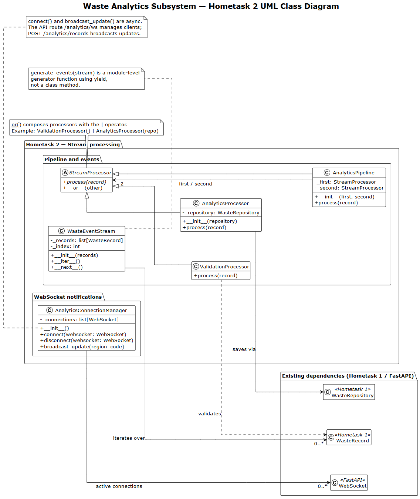

# Waste Sorting and Recycling Assistant

## Hometask2. Real-Time Data Processing
>
>The aim of this work is to learn to work with  streaming architectures and real-time data pipelines, processing events on the fly requires clean object-oriented abstractions. In this homeworkassignment, you will design and implement an event-driven stream processing framework using key Object-Oriented Programming (OOP) concepts in Python.
>
> ### Requirements & Technical Specifications. Code Implementation
>
> Your implementation must explicitly demonstrate the following concepts:
> 1. Abstract Base Classes (ABCs): Defining interface contracts with @abstractmethod.
> 2. Inheritance & Polymorphism: Creating specialized stream processors that adhere to a uniform API.
> 3. Operator Overloading: Overloading __add__ (or __or__) to compose processing pipelines intuitively.
> 4. Iterators & Generators: Implementing __iter__ and __next__ for stream consumption.
>
> Context: Processes real-time image recognition payloads from automated conveyor belt optical sorters.
> 
> Pipeline Goal:
> 1. Filter out low-confidence material classification predictions.
> 2. Transform bounding box metrics and visual tags into material categories (e.g., PET, HDPE, Aluminum) and conveyor routing codes.
---
### Waste Classification & Sorting Subsystem

**Responsible:** Evgenii Kuryshev

At this stage, the subsystem processes a sequence of waste images as a stream of events. It prepares and classifies one image at a time, records every prediction, and passes only predictions with at least 70% confidence through a separate filter. The demonstration writes the results to two JSONL files: one with all predictions and one with the accepted predictions. This stream demonstration does not look up regional disposal recommendations.

#### Classes

**Retained from Hometask 1**

- `ImageQuery` holds the image bytes and selected region for one recommendation request.
- `ImageProcessor` opens an image, converts it to RGB and pads it to 224 × 224 pixels.
- `WasteClassifier` loads the pretrained ResNet50 weights and predicts a waste label with its confidence.
- `ClassificationResult` holds the predicted waste label and confidence.
- `ClassMapping` converts a model label to a material name used by the regional rules.
- `RegionalRulesService` reads regional rules from a JSON file and finds a category and instruction.
- `Category` defines the four disposal categories: `unknown`, `recyclable`, `compostable` and `landfill`.
- `DisposalRecommendation` holds the result of a recommendation request.
- `DisposalRecommendationEngine` coordinates classification and regional rule lookup for a recommendation request.

The Hometask 2 stream reuses `ImageProcessor`, `WasteClassifier` and the `ClassificationResult` returned by the classifier. The other Hometask 1 classes remain available for the recommendation scenario.

**Added in Hometask 2**

- `PredictionEvent` holds an image ID, predicted class, confidence and whether the confidence meets the threshold.
- `StreamProcessor` is an abstract base class that requires a `process()` method and supports pipeline composition with `|`.
- `ImageClassifierProcessor` reads one image, prepares it and turns the classifier's result into a `PredictionEvent`.
- `JsonlWriter` writes each event as one JSON line; the pipeline uses one instance for all predictions and another for accepted predictions.
- `ConfidenceFilter` lets events above the threshold continue and stops the others.
- `Pipeline` runs composed processors in order. Its `|` operator adds another processor to the pipeline.
- `PredictionStream` implements `__iter__()` and `__next__()` to consume image paths one at a time and yield accepted events.

#### Class Diagram

To be added.

#### Model & Data

The subsystem uses the pretrained [ResNet50 Garbage Classification v1.2](https://huggingface.co/kendrickfff/my_resnet50_garbage_classificationv1.2) model. It predicts one of 12 waste labels. The demo accepts JPEG, PNG and WebP images; `ImageProcessor` converts each image to a 224 × 224 RGB input for the classifier. See the [model README](classification_subsystem/backend/model/README.md) for the training data, complete label list and limitations.

The conveyor belt examples come from the [WaRP (Waste Recycling Plant) dataset](https://github.com/AIRI-Institute/WaRP/tree/main), specifically its `Warp-C/test_crops` classification images. The `examples` folder contains 15 randomly selected photos from each of five source folders: `glass-green`, `glass-dark`, `cans`, `milk-cardboard` and `juice-cardboard`, alongside the five earlier example images. WaRP-C provides cropped images of individual waste items, which can be passed to the existing single-image classifier.

#### Run

From the repository root, activate your Python environment and run:

```powershell
cd classification_subsystem/backend
python -m pip install -r requirements.txt
python demo_hw2.py
```

The demo reads supported images from `examples` one at a time and prints the total and accepted counts. On every run, it replaces `output/all_predictions.jsonl` with all predictions and `output/accepted_predictions.jsonl` with predictions at or above the 70% confidence threshold. Each JSON line contains `image_id`, `class`, `confidence` and `above_threshold`; it does not contain a disposal recommendation.

---

### Waste Analytics & Dashboard Subsystem

**Responsible:** Anastasiia Shovkova

At this stage, the subsystem processes waste classification records as a stream of events. It validates each record through a processing pipeline, stores accepted records in an in-memory repository, and supports real-time analytics notifications through WebSocket connections. The implementation demonstrates abstract classes, inheritance, polymorphism, operator overloading, iterators, and generators.

#### Classes

**Retained from Hometask 1**

- `Category` defines four waste categories: `recyclable`, `compostable`, `landfill`, and `unknown`.
- `WasteRecord` holds the classified item, category, region code, unique ID, and creation timestamp.
- `WasteRepository` stores records in memory and provides methods to add, retrieve, and filter records.
- `WasteAnalyticsService` calculates category distribution, recyclable share, statistics, and daily trends.
- `StatisticsSummary` holds the calculated statistics for a selected region.
- `TrendPoint` represents waste category counts for a specific date.
- `AnalyticsController` provides access to the analytics service.
- `Dashboard` displays analytics results in the console.

**Added in Hometask 2**

- `StreamProcessor` is an abstract base class that defines the `process()` method and supports pipeline composition with the `|` operator.
- `AnalyticsPipeline` combines two stream processors and executes them sequentially.
- `ValidationProcessor` checks incoming waste records and rejects invalid data.
- `AnalyticsProcessor` saves validated records through the repository.
- `WasteEventStream` implements `__iter__()` and `__next__()` to process waste records one at a time.
- `AnalyticsConnectionManager` manages WebSocket connections and broadcasts analytics update notifications.

The Hometask 2 stream processing uses `ValidationProcessor` and `AnalyticsProcessor`. The `|` operator creates an `AnalyticsPipeline`, allowing records to pass through validation before being saved.

The `generate_events(stream)` function uses `yield` to produce records one at a time. It is a module-level generator function, not a class method.

#### Class Diagram



#### Model & Data

The Waste Analytics Subsystem does not use a separate machine learning model. It processes classification results represented as `WasteRecord` objects.

The demonstration includes four waste records representing different disposal categories and regions. Valid records are processed through the pipeline and saved in an in-memory `WasteRepository`.

The `AnalyticsConnectionManager` supports asynchronous WebSocket notifications using the `analytics_updated` event. WebSocket API integration is handled separately by the FastAPI application.

#### Run

From the repository root, activate your Python environment and run:

```powershell
cd dashboard_subsystem
python -m pip install -r requirements.txt
python -m waste_analytics.pipeline_demo
```

The demo processes four records through the validation and analytics pipeline.

Expected output:

```text
Processed: Plastic bottle
Processed: Banana peel
Processed: Diaper
Processed: Unknown object
Total records: 4
```

To run the Hometask 2 tests:

```powershell
python -m pytest tests/test_pipeline.py -v
```

The three tests verify invalid-record rejection, iterator behavior, and pipeline processing with a generator.

**Test result:** 3 passed.
