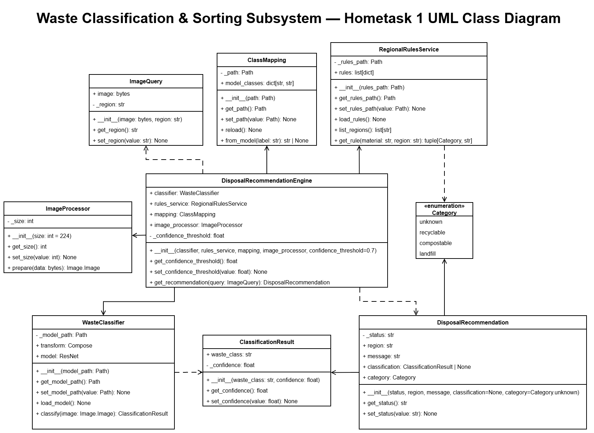

# Waste Sorting and Recycling Assistant

## Hometask 1. Object Oriented Concepts
> 
>The primary goal of this assignment is to translate the high-level architecture designed in your Capstone Project UML diagrams into concrete Object-Oriented Programming (OOP) class implementations.
> 
> ### Requirements & Technical Specifications. Code Implementation
> 
> - Per Team Member Requirement: Every student in the team must implement at least 3 unique classes corresponding to their assigned subsystem.
> - Class Requirements: Each class must include:
>   1. Constructor (`__init__`): Proper state initialization.
>   2. Initialization Methods: Setup or configuration logic where applicable.
>   3. Encapsulation (Getters & Setters): Accessor and mutator methods for class attributes.
---
### Waste Classification & Sorting Subsystem

**Responsible:** Evgenii Kuryshev

At this stage, the subsystem classifies photos of waste with a pretrained CV model and looks up sorting instructions for the selected region in a local JSON file. For a prediction with at least 70% confidence, it returns the material, disposal category and recommendation; otherwise, it asks for another photo.

#### Classes

- `ImageQuery` holds the image bytes and selected region for one request.
- `ImageProcessor` opens an image, converts it to RGB and pads it to 224 × 224 pixels.
- `WasteClassifier` loads the pretrained ResNet50 weights and predicts a waste label with its confidence.
- `ClassificationResult` holds the predicted waste label and confidence.
- `ClassMapping` converts a model label to a material name used by the regional rules.
- `RegionalRulesService` reads the rules from a JSON file and finds a category and instruction for a material in a region.
- `Category` defines the four disposal categories: `unknown`, `recyclable`, `compostable` and `landfill`.
- `DisposalRecommendation` holds the status, recommendation message, classification result and category returned to the user.
- `DisposalRecommendationEngine` coordinates image preparation, classification, label mapping and the regional rule lookup. Predictions below 70% confidence return a request for another photo.

#### Class Diagram



#### Model

The subsystem uses the pretrained [ResNet50 Garbage Classification v1.2](https://huggingface.co/kendrickfff/my_resnet50_garbage_classificationv1.2) model. It predicts one of 12 waste labels. The demo accepts JPEG, PNG and WebP images; `ImageProcessor` converts each image to a 224 × 224 RGB input for the classifier. See the [model README](classification_subsystem/backend/model/README.md) for the training data, complete label list and limitations.

#### Run

From the repository root:

```powershell
cd classification_subsystem/backend
python -m pip install -r requirements.txt
python demo.py
```

By default, `demo.py` processes every supported image in `examples` using the Dortmund rules. To process one image or select another region:

```powershell
python demo.py examples/cardboard.jpg --region Bochum
```
---
### AI Assistant Subsystem

**Responsible:** Illia Parkhomenko

#### Classes

To be added.

#### Class Diagram

To be added.

#### Run

To be added.
---
### Waste Analytics & Dashboard Subsystem

**Responsible:** Anastasiia Shovkova

#### Classes

To be added.

#### Class Diagram

To be added.

#### Run

To be added.
