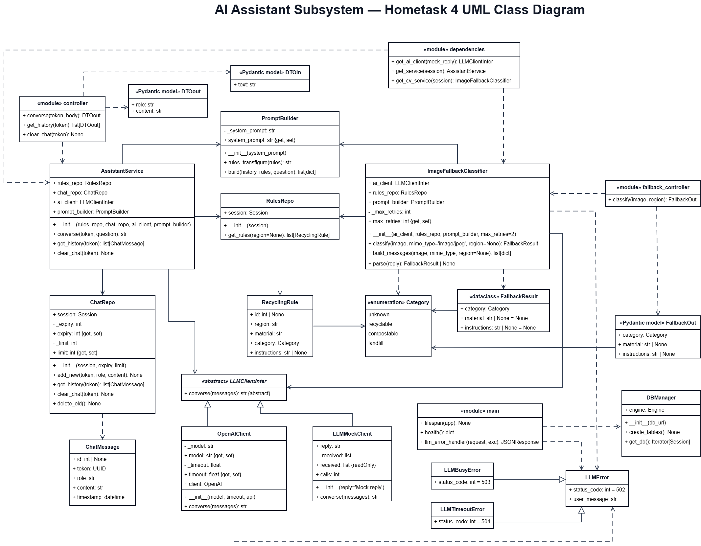

# Waste Sorting and Recycling Assistant

## Hometask4. Exception Handling and Unit tests

> The aim of this work is to learn how to handle error in your application and  testing princples in Django/Flask.
> 
> Please learn the principles of error handling https://docs.python.org/3/tutorial/errors.html
> 
> Create an error-handling class for each subsystem.
> 
> Create 15 different tests for your application.
---

### Team Video Presentation

[Watch the Hometask 4 team presentation](https://drive.google.com/file/d/1vBMnyN5Uf3zC3Vj0LHJQCAcRN04yxPjF/view)

---
### Waste Classification & Sorting Subsystem

**Responsible:** Evgenii Kuryshev

In Hometask 4, the subsystem adds error handling and automated tests to the classification, regional-rules and API workflow built in Hometasks 1–3. Invalid image data and missing disposal rules now raise `ClassificationError`. The FastAPI endpoint returns a clear HTTP error: `400` for an invalid image or region and `422` for a missing rule.

Fifteen tests cover image preparation, class mapping, regional rules, confidence filtering, CV and AI recommendation paths, and API responses.

#### Tests

1. A valid photo is prepared as a 224 × 224 RGB image.
2. Invalid image data raises `ClassificationError`.
3. A model label is mapped to a material; an unknown label has no mapping.
4. An existing regional rule returns its category and instructions.
5. A missing regional rule raises `ClassificationError` with status `422`.
6. A confidence threshold outside the range from 0 to 1 is rejected.
7. A confident CV prediction uses the regional rule and is sent to analytics.
8. An uncertain CV prediction uses the AI recommendation and is not sent to analytics.
9. An AI response without instructions asks the user for another photo.
10. An uncertain prediction without an AI fallback asks for another photo.
11. An unsupported region is rejected.
12. The confidence filter removes low-confidence prediction events.
13. The API handler returns a recommendation for a valid image and region.
14. The API handler returns status `400` for invalid image data.
15. The API handler returns status `422` when a regional rule is missing.

#### Test Coverage

Measured with `pytest-cov`: **70% of the subsystem (240 of 344 statements)** is covered. All 15 tests pass.

| File | Statements | Missed | Coverage |
|---|---:|---:|---:|
| `engine.py` | 39 | 0 | 100% |
| `models.py` | 46 | 0 | 100% |
| `image_processing.py` | 18 | 0 | 100% |
| `errors.py` | 4 | 0 | 100% |
| `regional_rules.py` | 24 | 1 | 96% |
| `class_mapping.py` | 18 | 1 | 94% |
| `main.py` | 43 | 10 | 77% |
| `stream_processing.py` | 69 | 34 | 51% |
| `wasteclassifier.py` | 30 | 18 | 40% |
| `analytics_client.py` | 12 | 8 | 33% |
| `fallback_client.py` | 20 | 15 | 25% |
| `db_config.py` | 21 | 17 | 19% |
| **Total** | **344** | **104** | **70%** |

#### Model

The subsystem uses [ResNet50 Garbage Classification v1.2](https://huggingface.co/kendrickfff/my_resnet50_garbage_classificationv1.2), which predicts one of 12 waste labels for an image. `ImageProcessor` prepares a 224 × 224 RGB image; `WasteClassifier` applies the normalization used by the included weights. The [model README](classification_subsystem/backend/model/README.md) lists the labels, training-data source and limitations.

#### Run

From the repository root, install the dependencies and run the 15 tests:

```powershell
python -m pip install -r classification_subsystem/backend/requirements.txt
python -m pytest classification_subsystem/backend/tests/test_subsystem.py -q
```

The tests use temporary local data and do not require service credentials.

---

## Waste Analytics & Dashboard Subsystem

**Responsible:** Anastasiia Shovkova

In Hometask 4, the Waste Analytics & Dashboard Subsystem adds exception handling and automated testing to the existing analytics architecture.

The subsystem uses a custom `WasteAnalyticsError` exception containing an error code and message. The `WasteAnalyticsErrorHandler` integrates with FastAPI and provides structured JSON error responses.

The tests cover analytics calculations, record validation, stream processing, API validation, and exception handling.

#### Class Diagram


### Classes

**Added in Hometask 4:**

- `WasteAnalyticsError` — represents a custom application error with a code and message.
- `WasteAnalyticsErrorHandler` — registers exception handling with FastAPI and converts application errors into JSON responses.

**Updated:**

- `api.py` — integrates the error handler with the existing API.
- `test_error_handler.py` — verifies exception handling.
- `test_api_validation.py` — checks API input validation.

### Tests

The subsystem was tested using Pytest.

The test suite includes checks for:

1. Waste record creation and attributes.
2. Category distribution calculations.
3. Recyclable share calculations.
4. Statistics generation.
5. Daily trend calculations.
6. Region-based record filtering.
7. Analytics controller operations.
8. Stream processing and validation.
9. Iterator and generator behavior.
10. API input validation and error handling.

These are the main areas covered by the test suite, rather than a one-to-one list of individual test functions.

**Test result: 18 passed, 1 warning.**

### Test Coverage

Measured using `pytest-cov`: **62% of the subsystem (309 of 500 statements) is covered.** All 18 tests pass.

| File | Statements | Missed | Coverage |
|---|---:|---:|---:|
| analytics_controller.py | 15 | 2 | 87% |
| analytics_processor.py | 7 | 0 | 100% |
| api.py | 104 | 54 | 48% |
| category.py | 6 | 0 | 100% |
| dashboard.py | 39 | 39 | 0% |
| database.py | 15 | 6 | 60% |
| db_models.py | 8 | 0 | 100% |
| error_handler.py | 21 | 0 | 100% |
| main.py | 19 | 19 | 0% |
| pipeline_demo.py | 17 | 17 | 0% |
| sql_waste_repository.py | 29 | 16 | 45% |
| statistics_summary.py | 27 | 5 | 81% |
| stream_processor.py | 16 | 2 | 88% |
| trend_point.py | 27 | 6 | 78% |
| validation_processor.py | 16 | 4 | 75% |
| waste_analytics_service.py | 65 | 8 | 88% |
| waste_event_stream.py | 15 | 0 | 100% |
| waste_record.py | 25 | 4 | 84% |
| waste_repository.py | 13 | 0 | 100% |
| websocket_manager.py | 16 | 9 | 44% |
| **Total** | **500** | **191** | **62%** |

The error handler achieves 100% statement coverage. The overall percentage includes API routes, WebSocket functionality, and console demonstration modules that are not fully exercised by the current tests.


### Run

From the repository root, install the dependencies:

`python -m pip install -r dashboard_subsystem/requirements.txt`

Install the coverage plugin if necessary:

`python -m pip install pytest-cov`

For local testing, enter the subsystem directory:

`cd dashboard_subsystem`

Enable SQLite in PowerShell:

`$env:USE_SQLITE = "1"`

Run all tests with coverage:

`python -m pytest tests --cov=waste_analytics --cov-report=term-missing`

**Expected test result:** 18 passed.

**Measured coverage:** 62%.

The local test configuration uses SQLite and does not require Neon database credentials.

### AI Assistant Subsystem

**Responsible:** Illia Parkhomenko

In Hometask 4, the subsystem adds error handling and automated tests to the chat assistant and the image fallback classifier built in Hometasks 1–3. Failures of the language model are translated into three custom exceptions derived from `LLMError`. The chat endpoint turns them into a clear HTTP error, and the image fallback returns the `unknown` category instead of failing.

#### Error Handling

| Exception | Raised when | HTTP status |
|---|---|---|
| `LLMError` | any other model error, or an empty reply | `502` |
| `LLMBusyError` | the model rate limit is reached | `503` |
| `LLMTimeoutError` | the model does not answer in time | `504` |

`OpenAIClient` translates the OpenAI SDK errors into these classes. Each class carries its status code and a user-facing message, and a single handler in `main.py` returns them to the client. `ImageFallbackClassifier` catches `LLMError` and returns `unknown`, so a model failure never breaks the photo flow.

#### Class Diagram



#### Tests

Eighteen tests use a mock language model and an in-memory SQLite database, so they need no API key or network.

1. The chat history is saved, returned and cleared.
2. The user question reaches the model and the reply is returned.
3. The prompt is built from the system prompt and the recycling rules.
4. The chat endpoint returns the assistant reply.
5. A valid model reply returns the category and instructions.
6. JSON wrapped in other text is still found.
7. An invalid reply is retried and then returns `unknown`.
8. The rules and the image reach the model.
9. The history is returned oldest first and respects the limit.
10. Clearing a chat removes only that session.
11. The chat endpoint returns status `504` when the model times out.
12. The fallback returns `unknown` when the model fails.
13. The fallback endpoint returns the classification JSON.
14. The fallback endpoint rejects non-image files with status `415`.
15. The mock client returns a fixed reply.
16. The mock client records the received messages.
17. The abstract client interface cannot be instantiated.
18. A negative `max_retries` value is rejected.

#### Test Coverage

Measured with `pytest-cov`: **86 % of the subsystem (278 of 323 statements)** is covered.

| File | Statements | Missed | Coverage |
|---|---|---|---|
| `cv_fallback_classes.py` | 48 | 0 | 100 % |
| `errors.py` | 9 | 0 | 100 % |
| `chat_handler_classes.py` | 44 | 2 | 95 % |
| `fallback_controller.py` | 19 | 1 | 95 % |
| `data_handler_classes.py` | 79 | 6 | 92 % |
| `controller.py` | 20 | 2 | 90 % |
| `main.py` | 24 | 3 | 88 % |
| `dependencies.py` | 25 | 6 | 76 % |
| `llm_access_classes.py` | 55 | 25 | 55 % |
| **Total** | **323** | **45** | **86 %** |

The retry logic of the fallback classifier and the exception classes are fully covered. The uncovered code is mostly the real `OpenAIClient` (property validation and the translation of OpenAI errors) and the startup code in `dependencies.py` that runs only when `OPENAI_API` is set. These parts need a real API key and network access, so the tests use the mock client instead.

#### Model

The assistant uses the OpenAI `gpt-6-luna` model through the OpenAI SDK for both the chat and the image fallback. Without the `OPENAI_API` variable, the subsystem works with a mock client and an in-memory SQLite database.

#### Run

From the repository root, install the dependencies and run the 18 tests:

```powershell
cd assistant_subsystem/backend
python -m pip install -r requirements.txt
python -m pytest
```

To measure the test coverage:

```powershell
python -m pytest --cov=src --cov-report=term-missing
```

To run the tests in Docker:

```powershell
docker build -t assistant-subsystem .
docker run --rm assistant-subsystem pytest /app/tests
```

The tests do not require service credentials.

---
