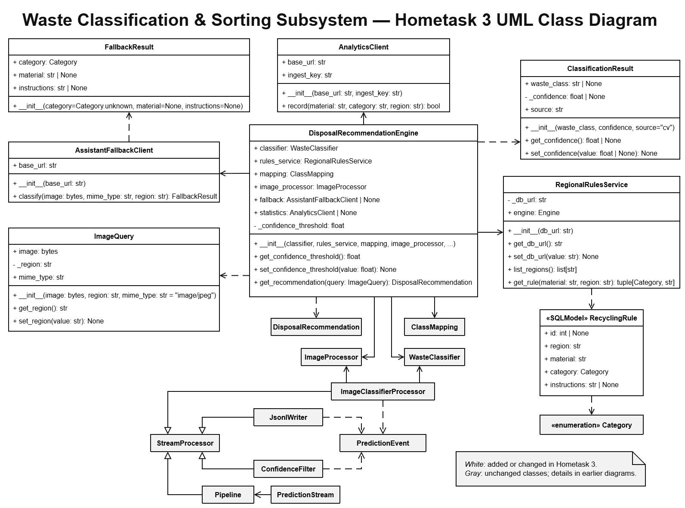

# AI-Powered Waste Sorting & Recycling Assistant

**Platform name:** DiliGen
**Subtopic:** CV- and LLM-Based Waste Awareness Assistant for German Citizens

## Team Overview

|       Member        | Matr. No. |          Subsystem         |
| ------------------- | --------- | -------------------------- |
| Anastasiia Shovkova | 7219229   | `dashboard_subsystem`      |
| Evgenii Kuryshev    | 7227176   | `classification_subsystem` |
| Illia Parkhomenko   | 7219649   | `assistant_subsystem`      |

---

## Presentation

[Watch the team video review](https://www.youtube.com/)

[Watch the team presentation slides](https://www.youtube.com/)

---

## How to Run the System

[Link to the website to be added]

[Docker / Application launching description to be added]

---

## Homework Mapping

Files and descriptions for each separate homework task can be found across the 4 branches:
* **Homeworkassignment001**
* **Homeworkassignment002**
* **Homeworkassignment003**
* **Homeworkassignment004**

---

## System Design

### Assistant subsystem

An educational chat about waste, recycling and the circular economy for German citizens, plus a one-shot image fallback. When the CV model cannot classify an image, the fallback asks an LLM and returns a category with disposal instructions. The chat uses the regional recycling rules stored in the database and keeps its history for a limited time, per browser session, with no accounts.

**Class diagram:**

### Classification subsystem

The subsystem accepts a waste photo and a city. A pretrained ResNet50 classifies the image into one of 12 model labels, which are mapped to the materials used by our regional rules. DisposalRecommendationEngine retrieves the category and disposal instruction from our separate Neon table. If CV confidence is too low, the subsystem can ask the assistant service to return a material from the list available for that city. If no material can be identified, it asks the user for another photo. When analytics is configured, it receives the material, category and region, without the recommendation text.

**Class diagram:**

### Dashboard subsystem

The dashboard block provides statistics for municipalities and responsible for collecting, processing, and presenting waste classification statistics for different regions. It reads the stored waste data and shows clear metrics and visualisations about waste composition as well as recycling-related rates.

---

## Tech Stack and Rationale

* **Backend: Python and FastAPI.** Asynchronous by design, with built-in support for WebSockets and streaming responses, which leaves room to stream AI answers later. We chose it over Django, which bundles user accounts, an admin panel and templates that we don't need, since the project has no logins. Flask is just as light, but it needs extra libraries for input validation and API documentation. FastAPI provides both out of the box: Pydantic checks every request (for example the 500-character limit on chat messages), and it generates an interactive API page (`/docs`) automatically.
* **Database and media storage: Neon.tech (serverless PostgreSQL) and Cloudinary.** Neon offers PostgreSQL with a free tier, so the team gets a hosted database with no server to maintain. We chose PostgreSQL over MySQL because it gives reliable transactions and is strong at the analytical queries the dashboard needs (grouping and aggregating waste records by region and time). Only image URLs go into the database, never raw image data. Cloudinary stores the images and serves them through a CDN.
* **ORM: SQLModel / SQLAlchemy.** Table models and API schemas use the same Python classes. It works the same with either database, so the application code does not depend on the PostgreSQL choice.
* **Data processing: Pandas.** It aggregates the raw logs on the backend into compact JSON for the dashboard. Plotting libraries stay out of the backend to save server resources.
* **Frontend and charts: React (Vite) with Recharts or Chart.js.** React handles the live chat state. Charts are drawn in the browser from the backend's JSON, so no static images are sent over the network.
* **AI model: OpenAI `gpt-6-luna`.** Our chat answers are short and our fallback only needs 1-3 values as a response, so a low-cost model is enough, and it keeps the API cost small for a student project. The model name is set in one place, so we can switch to a stronger model without changing the code.
* **Deployment: Netlify and Render.** The frontend and backend are deployed separately. Netlify hosts the React build, and Render runs the FastAPI service. Both deploy automatically when we push to GitHub.
* **Version control and CI/CD: GitHub.** One repository holds all three subsystems. Each task has its own branch, and pushes trigger the deployments.
* **Testing: Pytest and HTTPX.** Pytest fixtures give each test a clean in-memory database. HTTPX and FastAPI's built-in test client exercise the endpoints without running a server, and the OpenAI client is replaced by a mock, so tests need no API key and cost nothing.

---
